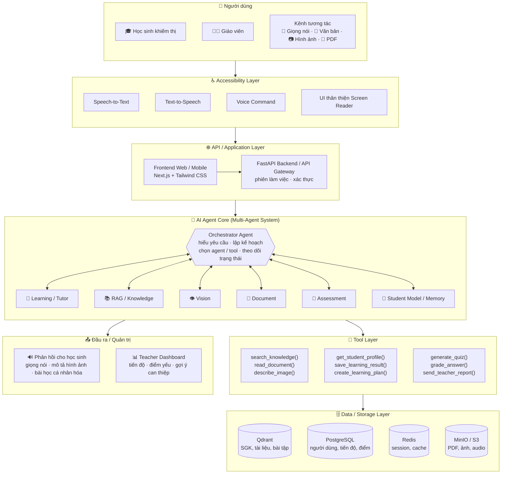
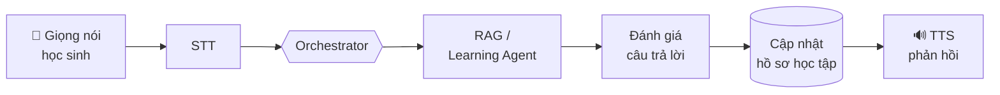

<div align="center">

# 🌟 LUSIA 🌟
## Hệ Thống AI Agent Hỗ Trợ Học Tập Cho Học Sinh Khiếm Thị
### *AI-Powered Learning Assistant for Visually Impaired Students*

**Voice-first • Multimodal • Agentic AI • RAG**


---

👂 **L**isten • 🧠 **U**nderstand • 🤝 **S**hare • ✨ **I**nspire • 🛠️ **A**ssist  
*Lắng nghe • Thấu hiểu • Chia sẻ • Truyền cảm hứng • Hỗ trợ*

---

*“Công nghệ vì con người – Giáo dục không để ai bị bỏ lại phía sau”*  
*“Tri thức được lắng nghe – Không còn rào cản”*

*Dự án tham dự cuộc thi **Vietnam - Japan AI Hackathon 2026 (VJAH 2026)***

</div>

---

## 📖 Mục lục (Table of Contents)
- [✨ Giới thiệu đề tài (Project Overview)](#-giới-thiệu-đề-tài-project-overview)
- [💡 Ý nghĩa tên gọi LUSIA (The Philosophy of LUSIA)](#-ý-nghĩa-tên-gọi-lusia-the-philosophy-of-lusia)
- [🎯 Bối cảnh & Điểm đau thực tế (Context & Pain Points)](#-bối-cảnh--điểm-đau-thực-tế-context--pain-points)
- [👥 Đối tượng phục vụ (Target Users)](#-đối-tượng-phục-vụ-target-users)
- [🚀 Tính năng nổi bật & Hệ sinh thái Agent (Core Features)](#-tính-năng-nổi-bật--hệ-sinh-thái-agent-core-features)
- [🧩 Kiến trúc hệ thống (System Architecture)](#-kiến-trúc-hệ-thống-system-architecture)
- [🎬 Kịch bản sử dụng (Demo Scenario)](#-kịch-bản-sử-dụng-demo-scenario)
- [🛠️ Công nghệ & Ngăn xếp kỹ thuật (Tech Stack)](#️-công-nghệ--ngăn-xếp-kỹ-thuật-tech-stack)
- [📁 Cấu trúc thư mục (Project Structure)](#-cấu-trúc-thư-mục-project-structure)
- [🛡️ Trí tuệ nhân tạo có trách nhiệm (Responsible AI)](#️-trí-tuệ-nhân-tạo-có-trách-nhiệm-responsible-ai)
- [📦 Hướng dẫn cài đặt & Khởi chạy (Getting Started)](#-hướng-dẫn-cài-đặt--khởi-chạy-getting-started)
- [🗺️ Lộ trình phát triển (Roadmap)](#️-lộ-trình-phát-triển-roadmap)
- [👥 Đội ngũ phát triển (Our Team)](#-đội-ngũ-phát-triển-our-team)

---

## ✨ Giới thiệu đề tài (Project Overview)

**LUSIA** là hệ sinh thái **AI Agent đa tác nhân (Multi-Agent System)** theo định hướng **Voice-first & Multimodal**, được thiết kế chuyên biệt nhằm đồng hành và hỗ trợ học tập cho **học sinh khiếm thị**.

Bằng việc kết hợp sức mạnh của **Generative AI, Retrieval-Augmented Generation (RAG)** và công nghệ thị giác máy tính đa phương thức, LUSIA mở ra cánh cửa tri thức bình đẳng, giúp học sinh khiếm thị có thể:
- Học tập hoàn toàn độc lập thông qua tương tác giọng nói hai chiều mà **không cần nhìn màn hình**.
- "Nhìn thấy" và hiểu trọn vẹn các biểu đồ, hình ảnh minh họa trong sách giáo khoa nhờ các tác nhân mô tả hình ảnh trực quan (Vision Agent).
- Tiếp cận kho học liệu sách giáo khoa chuẩn hóa được cá nhân hóa theo tốc độ tiếp thu của từng em.
- Kết nối chặt chẽ giữa học sinh và giáo viên thông qua bảng điều khiển theo dõi tiến độ học tập thông minh.

---

## 💡 Ý nghĩa tên gọi LUSIA (The Philosophy of LUSIA)

Đối với học sinh khiếm thị, đôi tai và trái tim là cầu nối lớn nhất tới thế giới tri thức. Từng chữ cái trong **LUSIA** là lời cam kết về một nền giáo dục hòa nhập:

| Ký tự | Từ khóa | Nghĩa Tiếng Việt | Vai trò trong hệ thống học tập cho học sinh khiếm thị |
| :---: | :--- | :--- | :--- |
| **L** | **Listen** | **Lắng nghe** | **Voice-first & Active Listening**: Lắng nghe mọi câu hỏi, phát âm, thắc mắc của học sinh bằng giọng nói tự nhiên thông qua hệ thống STT chuyên biệt. |
| **U** | **Understand** | **Thấu hiểu** | **Context & Visual Understanding**: Thấu hiểu nội dung học tập, "đọc vị" hình ảnh/đồ thị/sơ đồ bằng Vision Agent để chuyển hóa thành mô tả âm thanh trực quan, đồng thời thấu hiểu năng lực và điểm yếu của từng học sinh. |
| **S** | **Share** | **Chia sẻ** | **Knowledge Sharing (RAG)**: Truy xuất và chia sẻ kho tri thức sách giáo khoa, tài liệu học tập, giáo án chuẩn xác, truyền tải qua giọng đọc tự nhiên, truyền cảm. |
| **I** | **Inspire** | **Truyền cảm hứng** | **Empowerment & Motivation**: Đóng vai trò người bạn gia sư tận tâm, luôn kiên nhẫn khích lệ tinh thần, thắp sáng niềm tin và khát vọng chinh phục tri thức của các em. |
| **A** | **Assist** | **Hỗ trợ** | **Actionable Agent Support**: Tự động giải thích bài học, tạo bài luyện tập (Quiz), chấm điểm, hướng dẫn làm bài từng bước và hỗ trợ giáo viên theo dõi tiến độ can thiệp. |

---

## 🎯 Bối cảnh & Điểm đau thực tế (Context & Pain Points)

Giáo dục hòa nhập là một quyền cơ bản, nhưng đối với hàng triệu học sinh khiếm thị trên thế giới và tại Việt Nam, con đường tiếp cận tri thức vẫn đối mặt với những "điểm đau" (Pain Points) nhức nhối:

### 💥 1. Điểm đau của Học sinh khiếm thị (Students' Pain Points)
- 🚫 **"Bức tường" nội dung trực quan (The Visual Content Wall)**:
  - Sách giáo khoa và tài liệu học tập chứa đầy **hình vẽ sinh học, đồ thị toán học, sơ đồ vật lý, lược đồ địa lý**. Trình đọc màn hình thông thường hoàn toàn "bất lực" trước hình ảnh, biến các môn khoa học tự nhiên thành rào cản bất khả thi.
- 😔 **Mất quyền tự chủ & Phụ thuộc người khác (Loss of Autonomy)**:
  - Muốn học bài, giải bài tập hay ôn thi, các em luôn cần người thân hoặc bạn bè ngồi đọc hộ từng câu chữ. Điều này tạo tâm lý tự ti, mặc cảm và tước đi sự tự lập trong học tập.
- 📚 **Học liệu Braille khan hiếm, cồng kềnh và đắt đỏ**:
  - Một bộ SGK thông thường khi in nổi chữ Braille có thể dày gấp 4–5 lần, chi phí sản xuất đắt đỏ, mất hàng tháng để chuyển ngữ và rất khó cập nhật kịp chương trình giáo dục mới.
- 🐢 **Thiếu người đồng hành kiên nhẫn (Pacing & Empathy Deficit)**:
  - Trong lớp học hòa nhập, thầy cô giảng bài theo tốc độ chung. Học sinh khiếm thị không theo kịp nhưng ngại hỏi lại. Khi về nhà, các em thiếu một "gia sư" có thể kiên nhẫn giảng đi giảng lại nhiều lần bằng ngôn ngữ miêu tả dễ hiểu.

### 💥 2. Điểm đau của Giáo viên & Nhà trường (Teachers' Pain Points)
- ⏳ **Quá tải & Thiếu công cụ sư phạm chuyên biệt**:
  - Giáo viên lớp hòa nhập phải quản lý 30–40 học sinh, không đủ thời gian và kỹ năng để tự tay chuyển đổi giáo án, sơ đồ thành dạng mô tả âm thanh cho học sinh khiếm thị.
- 🔍 **Mất dấu tiến trình & "Điểm mù" trong đánh giá (Assessment Blind Spots)**:
  - Thầy cô rất khó biết chính xác học sinh khiếm thị đang bị hổng kiến thức ở khâu nào: do không hiểu bản chất bài học, hay do không hình dung được hình vẽ/biểu đồ minh họa.

### 💥 3. Hạn chế của Công nghệ hiện tại (Limitations of Existing Tech)
- **Screen Reader truyền thống (NVDA, TalkBack, VoiceOver)**: Giọng đọc cơ học, thiếu cảm xúc, không ngắt nghỉ sư phạm, không phân tích ngữ nghĩa hình ảnh và không thể tương tác hỏi - đáp hai chiều.
- **Chatbot AI thông thường**: Giao diện phụ thuộc vào việc nhìn màn hình và gõ phím; câu trả lời dài dòng không tối ưu cho thính giác; dễ xảy ra hiện tượng "ảo giác" (Hallucination) do không neo vào sách giáo khoa chuẩn.

---

### 💡 Bảng đối chiếu: Điểm đau ➡️ Giải pháp LUSIA (Pain-to-Solution Matrix)

| Điểm đau thực tế (Pain Point) | Thách thức cốt lõi | Giải pháp của **LUSIA** |
| :--- | :--- | :--- |
| **Không thể xem hình ảnh / đồ thị** | Trình đọc màn hình chỉ đọc văn bản, bỏ qua sơ đồ | **Vision Agent**: Tự động nhận diện, phân tích và "thuyết minh" đồ thị, hình ảnh bằng âm thanh trực quan. |
| **Phụ thuộc người đọc hộ** | Không tự chủ học bài, ôn thi lúc ở nhà | **Voice-first Two-way Dialog**: Tương tác đàm thoại 100% bằng giọng nói hai chiều, tự học độc lập. |
| **Học liệu Braille thiếu thốn** | Sách nổi in chậm, cồng kềnh, chi phí cao | **Document Agent + RAG**: Đọc hiểu SGK điện tử, OCR tức thì tài liệu PDF thành giọng đọc chuẩn. |
| **Hổng kiến thức, ngại hỏi** | Không có người kiên nhẫn giảng lại | **Learning/Tutor Agent**: Gia sư AI kiên nhẫn 24/7, giảng lại nhiều cách, gợi mở tư duy. |
| **Giáo viên quá tải, khó theo dõi** | Thiếu công cụ giám sát tiến độ học tập đặc thù | **Teacher Dashboard**: Tự động thống kê điểm nghẽn nhận thức, gợi ý can thiệp sư phạm kịp thời. |

---

> **Sứ mệnh của LUSIA:** Biến công nghệ AI thành "đôi mắt thứ hai" và "người bạn đồng hành tận tâm", giúp mọi học sinh khiếm thị tự tin làm chủ con đường học tập.

---

## 👥 Đối tượng phục vụ (Target Users)

### 1. 🎓 Học sinh khiếm thị (Visually Impaired Students)
- Học tập độc lập, chủ động tra cứu và nghe giảng giải mọi lúc mọi nơi.
- Tương tác hoàn toàn bằng giọng nói tự nhiên, không cần nhìn màn hình.
- Được hỗ trợ "đọc" hình ảnh, đồ thị, bảng biểu thông qua mô tả ngữ nghĩa chi tiết.

### 2. 👩‍🏫 Giáo viên & Nhà trường (Teachers & Educators)
- Hệ thống **Teacher Dashboard** hỗ trợ theo dõi tiến trình học tập, thống kê các chủ đề học sinh gặp khó khăn.
- Gợi ý phương pháp và thời điểm can thiệp sư phạm kịp thời, đồng hành cùng học sinh hiệu quả hơn.

---

## 🚀 Tính năng nổi bật & Hệ sinh thái Agent (Core Features)

Hệ thống được vận hành bởi kiến trúc **Multi-Agent (Đa tác nhân)** chuyên trách:

### 1. Tầng trợ năng & tương tác không nhìn (Accessibility Layer)
- **Speech-to-Text (STT)**: Chuyển đổi giọng nói học sinh thành văn bản với độ trễ thấp, hỗ trợ tiếng Việt và tiếng Nhật.
- **Text-to-Speech (TTS)**: Giọng đọc truyền cảm, tốc độ tùy biến, phát âm chuẩn xác thuật ngữ khoa học và SGK.
- **Voice Command & Non-visual UI**: Điều hướng toàn bộ ứng dụng chỉ bằng khẩu lệnh và cử chỉ âm thanh, tương thích hoàn hảo với Screen Reader.

### 2. Hệ thống Tác nhân thông minh (AI Agent Core)
- 🎯 **Orchestrator Agent**: "Nhạc trưởng" tiếp nhận yêu cầu, phân tích ý định, lập kế hoạch và điều phối các agent chuyên biệt.
- 📖 **Learning / Tutor Agent**: Giảng giải bài học theo phương pháp gợi mở, giải thích lại nhiều lần bằng ví dụ gần gũi, cá nhân hóa theo trình độ.
- 📚 **RAG / Knowledge Agent**: Truy xuất chính xác nội dung sách giáo khoa, bài tập và giáo án chuẩn từ cơ sở tri thức đã kiểm chứng.
- 👁️ **Vision Agent**: Đọc hiểu và chuyển đổi hình ảnh, đồ thị hàm số, bản đồ địa lý, sơ đồ sinh học thành các đoạn mô tả chi tiết bằng âm thanh.
- 📄 **Document Agent**: OCR tài liệu học tập, đọc file PDF, tóm tắt các bài học dài thành các ý trọng tâm dễ nhớ.
- 📝 **Assessment Agent**: Tự động sinh câu hỏi trắc nghiệm/tự luận bằng giọng nói, chấm bài tức thì và giải thích cặn kẽ đáp án.
- 🧠 **Student Model & Memory**: Ghi nhớ lịch sử học tập, môn học, phân tích điểm mạnh, điểm yếu và sở thích của từng em để tối ưu lộ trình.

### 3. Cổng thông tin cho giáo viên (Teacher Dashboard)
- Giám sát tiến độ học tập theo thời gian thực.
- Cảnh báo sớm các lỗ hổng kiến thức để giáo viên hỗ trợ kịp thời.

---

## 🧩 Kiến trúc hệ thống (System Architecture)



**Luồng hoạt động chính:**



> 🖼️ Bản thiết kế đồ họa đầy đủ: [docs/architecture.webp](docs/architecture.webp)

---

## 🎬 Kịch bản sử dụng (Demo Scenario)

> 🎓 *"LUSIA ơi, giải thích giúp mình đồ thị trong bài Hàm số bậc nhất, sách Toán 8."*  
> 🤖 **Knowledge Agent** tìm đúng bài trong SGK → **Vision Agent** mô tả: *"Đây là đồ thị hàm số y = 2x + 1: một đường thẳng đi lên từ trái sang phải, cắt trục tung tại điểm có tung độ bằng 1…"*  
> 🎓 *"Vì sao nó cắt trục tung ở 1?"*  
> 🤖 **Tutor Agent** gợi mở: *"Em thử thay x = 0 vào công thức xem y bằng bao nhiêu nhé?"*  
> 📝 Cuối buổi, **Assessment Agent** hỏi 3 câu trắc nghiệm bằng giọng nói; kết quả được ghi vào Student Model và hiển thị trên **Teacher Dashboard**.

---

## 🛠️ Công nghệ & Ngăn xếp kỹ thuật (Tech Stack)

- **AI & Multi-Agent Core**: LLM (Gemini, Claude, GPT), Agent Frameworks (LangChain, LangGraph), RAG Pipeline.
- **Voice & Accessibility**: Whisper / WhisperX (Speech-to-Text), Neural TTS (Việt - Nhật), Web Speech API.
- **Vision & Document Processing**: Multimodal Vision LLM, OCR (Tesseract / PaddleOCR / Surya), PDF Parsers.
- **Backend & API Gateway**: Python **FastAPI** (Uvicorn).
- **Frontend**: **Next.js** (App Router, TypeScript) + **Tailwind CSS** — Responsive Web & Mobile, High Contrast, Screen Reader Friendly (WAI-ARIA).
- **Cơ sở dữ liệu & Lưu trữ (Data & Storage)**:
  - **Vector DB**: Qdrant (Lưu trữ và truy xuất ngữ nghĩa tài liệu SGK).
  - **Relational DB**: PostgreSQL / MySQL (Quản lý hồ sơ học sinh, giáo viên, tiến độ).
  - **In-Memory Cache**: Redis (Quản lý phiên đàm thoại, trạng thái ngắn hạn của Agent).
  - **Object Storage**: MinIO / AWS S3 (Lưu trữ file âm thanh, tài liệu PDF, hình ảnh bài học).

---

## 📁 Cấu trúc thư mục (Project Structure)

Mỗi thư mục tương ứng một tầng trong [sơ đồ kiến trúc](#-kiến-trúc-hệ-thống-system-architecture):

```text
Hackathon_VJAI/
├── frontend/                  # Next.js (App Router) + Tailwind CSS
│   └── src/app/
│       ├── layout.tsx         # Layout chung (lang="vi" cho trình đọc màn hình)
│       ├── page.tsx           # Trang chủ: chọn Học sinh / Giáo viên
│       ├── learn/             # Giao diện học sinh (voice-first)
│       └── dashboard/         # Teacher Dashboard
├── backend/                   # Python FastAPI
│   ├── app/
│   │   ├── main.py            # API / Application Layer: khởi tạo app, CORS, router
│   │   ├── api/               # Endpoint: chat.py (học sinh), teacher.py (giáo viên)
│   │   ├── voice/             # Accessibility Layer: stt.py, tts.py
│   │   ├── agents/            # AI Agent Core: orchestrator, tutor, knowledge,
│   │   │                      #   vision, document, assessment, student_model
│   │   ├── tools.py           # Tool Layer: search_knowledge(), generate_quiz(), …
│   │   └── storage/           # Data Layer: vector (Qdrant), relational (PostgreSQL),
│   │                          #   cache (Redis), files (MinIO / S3)
│   ├── requirements.txt
│   └── .env.example
├── docker-compose.yml         # Khởi chạy toàn bộ hạ tầng: Qdrant, Redis, Postgres, MinIO
└── docs/
    └── architecture.webp      # Sơ đồ kiến trúc hệ thống
```

---

## 🛡️ Trí tuệ nhân tạo có trách nhiệm (Responsible AI)

- 🔒 **Privacy (Bảo mật quyền riêng tư)**: Dữ liệu giọng nói và thông tin học tập của học sinh được bảo vệ tuyệt đối theo chuẩn an toàn.
- 🛡️ **Safety & Content Moderation**: Lọc bỏ các nội dung không phù hợp lứa tuổi học đường.
- ♿ **Accessibility (Chuẩn trợ năng quốc tế)**: Tuân thủ các tiêu chuẩn WCAG 2.1 AA/AAA về khả năng tiếp cận cho người khiếm thị.
- 🎯 **Hallucination Control**: Kiểm soát hiện tượng ảo giác của AI thông qua RAG đối chiếu trực tiếp với Sách giáo khoa chính thống.
- 👥 **Human Oversight**: Luôn có sự giám sát và đồng hành của giáo viên trong suốt quá trình học tập.

---

## 📦 Hướng dẫn cài đặt & Khởi chạy (Getting Started)

> ℹ️ Khung dự án (frontend + backend) đã được khởi tạo; các agent đang được phát triển trong khuôn khổ VJAH 2026.

### 1. Yêu cầu tiên quyết (Prerequisites)
- Python >= 3.10
- Node.js >= 20.9
- Docker (chạy Qdrant, Redis, PostgreSQL)
- Micro & Loa thiết bị hoạt động tốt

### 2. Clone repository

```bash
git clone https://github.com/DatTQ27/Hackathon_VJAI.git
cd Hackathon_VJAI
```

### 3. Khởi chạy dịch vụ nền (Docker Compose)

Khởi động đồng thời tất cả dịch vụ dữ liệu với 1 lệnh duy nhất:

```bash
docker compose up -d
```

> 💡 **Các cổng dịch vụ đã sẵn sàng:**
> - **Qdrant (Vector DB)**: <http://localhost:6333/dashboard> (Web UI)
> - **Redis (Cache & Session)**: `localhost:6379`
> - **PostgreSQL**: `localhost:5432` (`db: lusia_db`, `user/pass: lusia/lusia`)
> - *(Tùy chọn) **MinIO**: Bỏ comment trong docker-compose.yml khi cần dùng Object Storage S3*
>
> *(Khi cần dừng dịch vụ: `docker compose down`)*

### 4. Backend (FastAPI)

```bash
cd backend
python3 -m venv .venv
source .venv/bin/activate      # Windows: .venv\Scripts\activate
pip install -r requirements.txt
cp .env.example .env           # Điền API key vào .env — không commit file này
uvicorn app.main:app --reload --port 8000 --env-file .env
```

Mở <http://localhost:8000/docs> để xem và thử API (Swagger UI).

### 5. Frontend (Next.js)

```bash
cd frontend
npm install
npm run dev
```

Mở <http://localhost:3000>.

---

## 🗺️ Lộ trình phát triển (Roadmap)

- [x] **Giai đoạn 1**: Định hình kiến trúc hệ sinh thái Multi-Agent, thiết kế tầng trợ năng Voice-first & triết lý **LUSIA**.
- [ ] **Giai đoạn 2 (VJAH 2026)**: Hoàn thiện bản mẫu MVP:
  - Agent gia sư đàm thoại giọng nói hai chiều (STT - TTS).
  - Tích hợp RAG tra cứu nội dung Sách giáo khoa.
  - Thử nghiệm tính năng Vision Agent mô tả đồ thị/hình ảnh cho người khiếm thị.
- [ ] **Giai đoạn 3**: Triển khai Teacher Dashboard và hệ thống đánh giá trắc nghiệm âm thanh.
- [ ] **Giai đoạn 4**: Hợp tác thử nghiệm thực tế tại các trường và trung tâm giáo dục chuyên biệt ở Việt Nam và Nhật Bản.

---

## 👥 Đội ngũ phát triển (Our Team)

Dự án được phát triển với tất cả tâm huyết vì một nền giáo dục hòa nhập:

- 🏆 **Cuộc thi**: Vietnam - Japan AI Hackathon 2026 (VJAH 2026)
- 💡 **Dự án**: **LUSIA** – *Listen • Understand • Share • Inspire • Assist*
- 🏫 **Đơn vị**: Trường Đại học Xây dựng Hà Nội (HUCE)

| Thành viên | Vai trò | GitHub |
| :--- | :--- | :--- |
| Triệu Quốc Đạt | _Đang cập nhật_ | [@DatTQ27](https://github.com/DatTQ27) |
| Phan Đức Duy | _Đang cập nhật_ | [@DuykoNgu](https://github.com/DuykoNgu) |

---

<div align="center">
  <sub>LUSIA • Công nghệ mở - Tri thức không giới hạn - Vì một nền giáo dục hòa nhập • VJAH 2026</sub>
</div>
