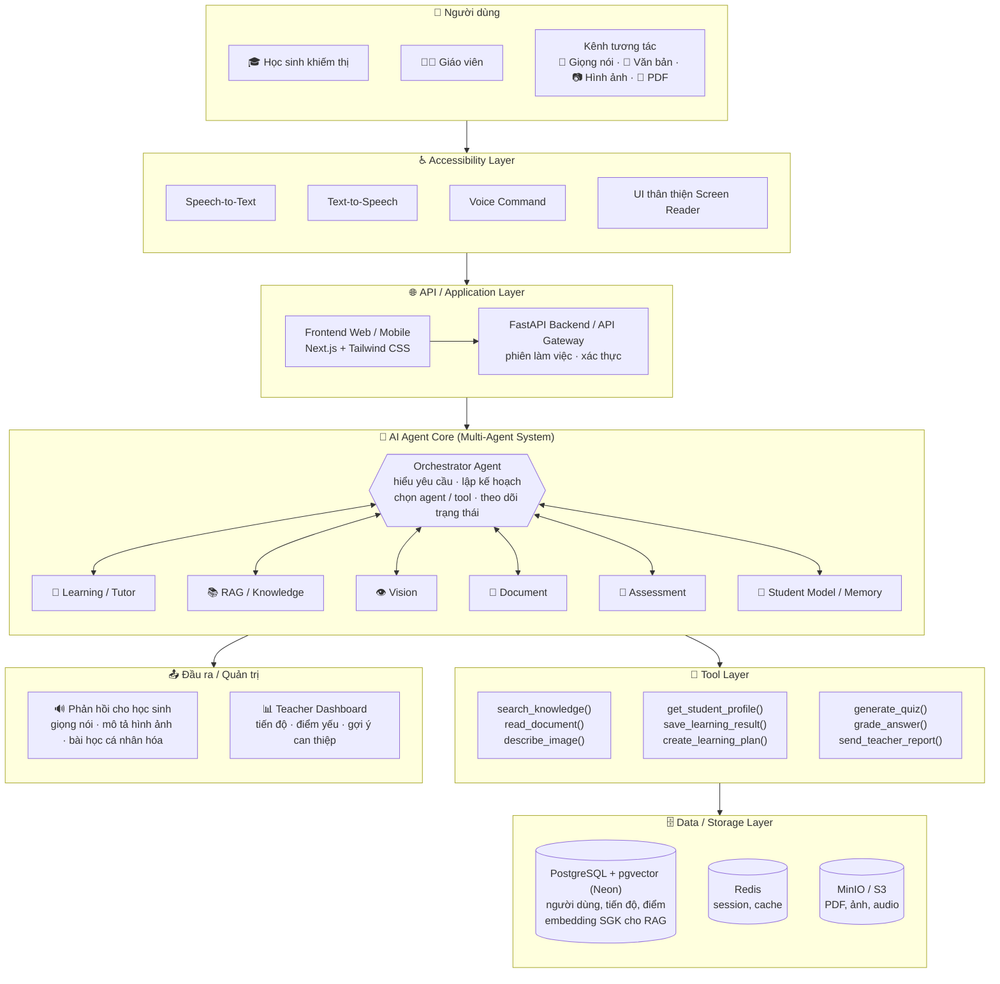
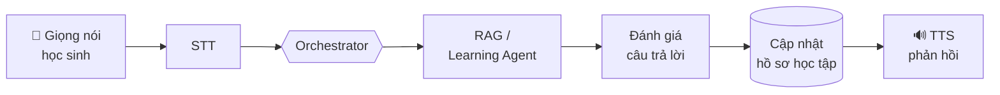
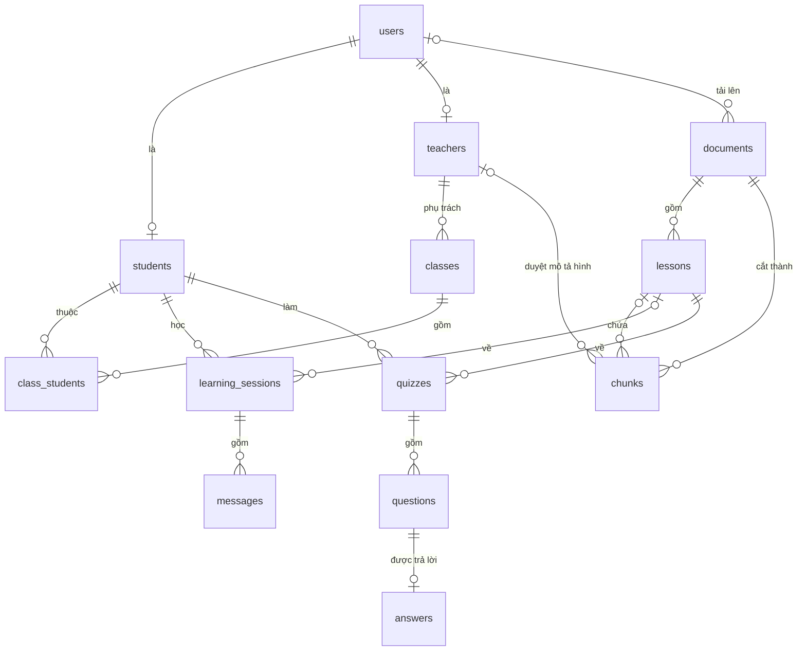

<div align="center">

# 🌟 LUSIA 🌟
## Hệ Thống AI Agent Hỗ Trợ Học Tập Cho Học Sinh Khiếm Thị
### *AI-Powered Learning Assistant for Visually Impaired Students*

**Voice-first • Multimodal • Agentic AI • RAG**


---

👂 **L**isten • 🧠 **U**nderstand • 🤝 **S**hare • ✨ **I**nspire • 🛠️ **A**ssist  
*Lắng nghe • Thấu hiểu • Chia sẻ • Truyền cảm hứng • Hỗ trợ*

---

*“Công nghệ vì con người – Giáo dục không để ai bị bỏ lại phía sau”*  
*“Tri thức được lắng nghe – Không còn rào cản”*

*Dự án tham dự cuộc thi **Vietnam - Japan AI Hackathon 2026 (VJAH 2026)***

</div>

---

## 📖 Mục lục (Table of Contents)
- [✨ Giới thiệu đề tài (Project Overview)](#-giới-thiệu-đề-tài-project-overview)
- [💡 Ý nghĩa tên gọi LUSIA (The Philosophy of LUSIA)](#-ý-nghĩa-tên-gọi-lusia-the-philosophy-of-lusia)
- [🎯 Bối cảnh & Điểm đau thực tế (Context & Pain Points)](#-bối-cảnh--điểm-đau-thực-tế-context--pain-points)
- [👥 Đối tượng phục vụ (Target Users)](#-đối-tượng-phục-vụ-target-users)
- [🚀 Tính năng nổi bật & Hệ sinh thái Agent (Core Features)](#-tính-năng-nổi-bật--hệ-sinh-thái-agent-core-features)
- [🧩 Kiến trúc hệ thống (System Architecture)](#-kiến-trúc-hệ-thống-system-architecture)
- [🎬 Kịch bản sử dụng (Demo Scenario)](#-kịch-bản-sử-dụng-demo-scenario)
- [🛠️ Công nghệ & Ngăn xếp kỹ thuật (Tech Stack)](#️-công-nghệ--ngăn-xếp-kỹ-thuật-tech-stack)
- [📁 Cấu trúc thư mục (Project Structure)](#-cấu-trúc-thư-mục-project-structure)
- [🗄️ Cơ sở dữ liệu (Database Schema)](#️-cơ-sở-dữ-liệu-database-schema)
- [🛡️ Trí tuệ nhân tạo có trách nhiệm (Responsible AI)](#️-trí-tuệ-nhân-tạo-có-trách-nhiệm-responsible-ai)
- [📦 Hướng dẫn cài đặt & Khởi chạy (Getting Started)](#-hướng-dẫn-cài-đặt--khởi-chạy-getting-started)
- [🗺️ Lộ trình phát triển (Roadmap)](#️-lộ-trình-phát-triển-roadmap)
- [👥 Đội ngũ phát triển (Our Team)](#-đội-ngũ-phát-triển-our-team)

---

## ✨ Giới thiệu đề tài (Project Overview)

**LUSIA** là hệ sinh thái **AI Agent đa tác nhân (Multi-Agent System)** theo định hướng **Voice-first & Multimodal**, được thiết kế chuyên biệt nhằm đồng hành và hỗ trợ học tập cho **học sinh khiếm thị**.

Bằng việc kết hợp sức mạnh của **Generative AI, Retrieval-Augmented Generation (RAG)** và công nghệ thị giác máy tính đa phương thức, LUSIA mở ra cánh cửa tri thức bình đẳng, giúp học sinh khiếm thị có thể:
- Học tập hoàn toàn độc lập thông qua tương tác giọng nói hai chiều mà **không cần nhìn màn hình**.
- "Nhìn thấy" và hiểu trọn vẹn các biểu đồ, hình ảnh minh họa trong sách giáo khoa nhờ các tác nhân mô tả hình ảnh trực quan (Vision Agent).
- Tiếp cận kho học liệu sách giáo khoa chuẩn hóa được cá nhân hóa theo tốc độ tiếp thu của từng em.
- Kết nối chặt chẽ giữa học sinh và giáo viên thông qua bảng điều khiển theo dõi tiến độ học tập thông minh.

---

## 💡 Ý nghĩa tên gọi LUSIA (The Philosophy of LUSIA)

Đối với học sinh khiếm thị, đôi tai và trái tim là cầu nối lớn nhất tới thế giới tri thức. Từng chữ cái trong **LUSIA** là lời cam kết về một nền giáo dục hòa nhập:

| Ký tự | Từ khóa | Nghĩa Tiếng Việt | Vai trò trong hệ thống học tập cho học sinh khiếm thị |
| :---: | :--- | :--- | :--- |
| **L** | **Listen** | **Lắng nghe** | **Voice-first & Active Listening**: Lắng nghe mọi câu hỏi, phát âm, thắc mắc của học sinh bằng giọng nói tự nhiên thông qua hệ thống STT chuyên biệt. |
| **U** | **Understand** | **Thấu hiểu** | **Context & Visual Understanding**: Thấu hiểu nội dung học tập, "đọc vị" hình ảnh/đồ thị/sơ đồ bằng Vision Agent để chuyển hóa thành mô tả âm thanh trực quan, đồng thời thấu hiểu năng lực và điểm yếu của từng học sinh. |
| **S** | **Share** | **Chia sẻ** | **Knowledge Sharing (RAG)**: Truy xuất và chia sẻ kho tri thức sách giáo khoa, tài liệu học tập, giáo án chuẩn xác, truyền tải qua giọng đọc tự nhiên, truyền cảm. |
| **I** | **Inspire** | **Truyền cảm hứng** | **Empowerment & Motivation**: Đóng vai trò người bạn gia sư tận tâm, luôn kiên nhẫn khích lệ tinh thần, thắp sáng niềm tin và khát vọng chinh phục tri thức của các em. |
| **A** | **Assist** | **Hỗ trợ** | **Actionable Agent Support**: Tự động giải thích bài học, tạo bài luyện tập (Quiz), chấm điểm, hướng dẫn làm bài từng bước và hỗ trợ giáo viên theo dõi tiến độ can thiệp. |

---

## 🎯 Bối cảnh & Điểm đau thực tế (Context & Pain Points)

Giáo dục hòa nhập là một quyền cơ bản, nhưng đối với hàng triệu học sinh khiếm thị trên thế giới và tại Việt Nam, con đường tiếp cận tri thức vẫn đối mặt với những "điểm đau" (Pain Points) nhức nhối:

### 💥 1. Điểm đau của Học sinh khiếm thị (Students' Pain Points)
- 🚫 **"Bức tường" nội dung trực quan (The Visual Content Wall)**:
  - Sách giáo khoa và tài liệu học tập chứa đầy **hình vẽ sinh học, đồ thị toán học, sơ đồ vật lý, lược đồ địa lý**. Trình đọc màn hình thông thường hoàn toàn "bất lực" trước hình ảnh, biến các môn khoa học tự nhiên thành rào cản bất khả thi.
- 😔 **Mất quyền tự chủ & Phụ thuộc người khác (Loss of Autonomy)**:
  - Muốn học bài, giải bài tập hay ôn thi, các em luôn cần người thân hoặc bạn bè ngồi đọc hộ từng câu chữ. Điều này tạo tâm lý tự ti, mặc cảm và tước đi sự tự lập trong học tập.
- 📚 **Học liệu Braille khan hiếm, cồng kềnh và đắt đỏ**:
  - Một bộ SGK thông thường khi in nổi chữ Braille có thể dày gấp 4–5 lần, chi phí sản xuất đắt đỏ, mất hàng tháng để chuyển ngữ và rất khó cập nhật kịp chương trình giáo dục mới.
- 🐢 **Thiếu người đồng hành kiên nhẫn (Pacing & Empathy Deficit)**:
  - Trong lớp học hòa nhập, thầy cô giảng bài theo tốc độ chung. Học sinh khiếm thị không theo kịp nhưng ngại hỏi lại. Khi về nhà, các em thiếu một "gia sư" có thể kiên nhẫn giảng đi giảng lại nhiều lần bằng ngôn ngữ miêu tả dễ hiểu.

### 💥 2. Điểm đau của Giáo viên & Nhà trường (Teachers' Pain Points)
- ⏳ **Quá tải & Thiếu công cụ sư phạm chuyên biệt**:
  - Giáo viên lớp hòa nhập phải quản lý 30–40 học sinh, không đủ thời gian và kỹ năng để tự tay chuyển đổi giáo án, sơ đồ thành dạng mô tả âm thanh cho học sinh khiếm thị.
- 🔍 **Mất dấu tiến trình & "Điểm mù" trong đánh giá (Assessment Blind Spots)**:
  - Thầy cô rất khó biết chính xác học sinh khiếm thị đang bị hổng kiến thức ở khâu nào: do không hiểu bản chất bài học, hay do không hình dung được hình vẽ/biểu đồ minh họa.

### 💥 3. Hạn chế của Công nghệ hiện tại (Limitations of Existing Tech)
- **Screen Reader truyền thống (NVDA, TalkBack, VoiceOver)**: Giọng đọc cơ học, thiếu cảm xúc, không ngắt nghỉ sư phạm, không phân tích ngữ nghĩa hình ảnh và không thể tương tác hỏi - đáp hai chiều.
- **Chatbot AI thông thường**: Giao diện phụ thuộc vào việc nhìn màn hình và gõ phím; câu trả lời dài dòng không tối ưu cho thính giác; dễ xảy ra hiện tượng "ảo giác" (Hallucination) do không neo vào sách giáo khoa chuẩn.

---

### 💡 Bảng đối chiếu: Điểm đau ➡️ Giải pháp LUSIA (Pain-to-Solution Matrix)

| Điểm đau thực tế (Pain Point) | Thách thức cốt lõi | Giải pháp của **LUSIA** |
| :--- | :--- | :--- |
| **Không thể xem hình ảnh / đồ thị** | Trình đọc màn hình chỉ đọc văn bản, bỏ qua sơ đồ | **Vision Agent**: Tự động nhận diện, phân tích và "thuyết minh" đồ thị, hình ảnh bằng âm thanh trực quan. |
| **Phụ thuộc người đọc hộ** | Không tự chủ học bài, ôn thi lúc ở nhà | **Voice-first Two-way Dialog**: Tương tác đàm thoại 100% bằng giọng nói hai chiều, tự học độc lập. |
| **Học liệu Braille thiếu thốn** | Sách nổi in chậm, cồng kềnh, chi phí cao | **Document Agent + RAG**: Đọc hiểu SGK điện tử, OCR tức thì tài liệu PDF thành giọng đọc chuẩn. |
| **Hổng kiến thức, ngại hỏi** | Không có người kiên nhẫn giảng lại | **Learning/Tutor Agent**: Gia sư AI kiên nhẫn 24/7, giảng lại nhiều cách, gợi mở tư duy. |
| **Giáo viên quá tải, khó theo dõi** | Thiếu công cụ giám sát tiến độ học tập đặc thù | **Teacher Dashboard**: Tự động thống kê điểm nghẽn nhận thức, gợi ý can thiệp sư phạm kịp thời. |

---

> **Sứ mệnh của LUSIA:** Biến công nghệ AI thành "đôi mắt thứ hai" và "người bạn đồng hành tận tâm", giúp mọi học sinh khiếm thị tự tin làm chủ con đường học tập.

---

## 👥 Đối tượng phục vụ (Target Users)

### 1. 🎓 Học sinh khiếm thị (Visually Impaired Students)
- Học tập độc lập, chủ động tra cứu và nghe giảng giải mọi lúc mọi nơi.
- Tương tác hoàn toàn bằng giọng nói tự nhiên, không cần nhìn màn hình.
- Được hỗ trợ "đọc" hình ảnh, đồ thị, bảng biểu thông qua mô tả ngữ nghĩa chi tiết.

### 2. 👩‍🏫 Giáo viên & Nhà trường (Teachers & Educators)
- Hệ thống **Teacher Dashboard** hỗ trợ theo dõi tiến trình học tập, thống kê các chủ đề học sinh gặp khó khăn.
- Gợi ý phương pháp và thời điểm can thiệp sư phạm kịp thời, đồng hành cùng học sinh hiệu quả hơn.

---

## 🚀 Tính năng nổi bật & Hệ sinh thái Agent (Core Features)

Hệ thống được vận hành bởi kiến trúc **Multi-Agent (Đa tác nhân)** chuyên trách:

### 1. Tầng trợ năng & tương tác không nhìn (Accessibility Layer)
- **Speech-to-Text (STT)**: Chuyển đổi giọng nói học sinh thành văn bản với độ trễ thấp, hỗ trợ tiếng Việt và tiếng Nhật.
- **Text-to-Speech (TTS)**: Giọng đọc truyền cảm, tốc độ tùy biến, phát âm chuẩn xác thuật ngữ khoa học và SGK.
- **Voice Command & Non-visual UI**: Điều hướng toàn bộ ứng dụng chỉ bằng khẩu lệnh và cử chỉ âm thanh, tương thích hoàn hảo với Screen Reader.

### 2. Hệ thống Tác nhân thông minh (AI Agent Core)
- 🎯 **Orchestrator Agent**: "Nhạc trưởng" tiếp nhận yêu cầu, phân tích ý định, lập kế hoạch và điều phối các agent chuyên biệt.
- 📖 **Learning / Tutor Agent**: Giảng giải bài học theo phương pháp gợi mở, giải thích lại nhiều lần bằng ví dụ gần gũi, cá nhân hóa theo trình độ.
- 📚 **RAG / Knowledge Agent**: Truy xuất chính xác nội dung sách giáo khoa, bài tập và giáo án chuẩn từ cơ sở tri thức đã kiểm chứng.
- 👁️ **Vision Agent**: Đọc hiểu và chuyển đổi hình ảnh, đồ thị hàm số, bản đồ địa lý, sơ đồ sinh học thành các đoạn mô tả chi tiết bằng âm thanh.
- 📄 **Document Agent**: OCR tài liệu học tập, đọc file PDF, tóm tắt các bài học dài thành các ý trọng tâm dễ nhớ.
- 📝 **Assessment Agent**: Tự động sinh câu hỏi trắc nghiệm/tự luận bằng giọng nói, chấm bài tức thì và giải thích cặn kẽ đáp án.
- 🧠 **Student Model & Memory**: Ghi nhớ lịch sử học tập, môn học, phân tích điểm mạnh, điểm yếu và sở thích của từng em để tối ưu lộ trình.

### 3. Cổng thông tin cho giáo viên (Teacher Dashboard)
- Giám sát tiến độ học tập theo thời gian thực.
- Cảnh báo sớm các lỗ hổng kiến thức để giáo viên hỗ trợ kịp thời.

---

## 🧩 Kiến trúc hệ thống (System Architecture)



**Luồng hoạt động chính:**



> 🖼️ Bản thiết kế đồ họa đầy đủ: [docs/architecture.webp](docs/architecture.webp)

---

## 🎬 Kịch bản sử dụng (Demo Scenario)

> 🎓 *"LUSIA ơi, giải thích giúp mình đồ thị trong bài Hàm số bậc nhất, sách Toán 8."*  
> 🤖 **Knowledge Agent** tìm đúng bài trong SGK → **Vision Agent** mô tả: *"Đây là đồ thị hàm số y = 2x + 1: một đường thẳng đi lên từ trái sang phải, cắt trục tung tại điểm có tung độ bằng 1…"*  
> 🎓 *"Vì sao nó cắt trục tung ở 1?"*  
> 🤖 **Tutor Agent** gợi mở: *"Em thử thay x = 0 vào công thức xem y bằng bao nhiêu nhé?"*  
> 📝 Cuối buổi, **Assessment Agent** hỏi 3 câu trắc nghiệm bằng giọng nói; kết quả được ghi vào Student Model và hiển thị trên **Teacher Dashboard**.

---

### ▶️ Chạy demo (MVP)

Trên một laptop, dùng **Google Chrome** (nhận giọng nói tiếng Việt qua Web Speech API; cần Internet).

```bash
docker compose up -d                                   # Postgres + Redis
cd backend && source .venv/bin/activate
python -m app.migrate && python -m app.seed            # schema + giáo viên colan, lớp 8A, học sinh minh8a
python -m app.voice.tts --download                     # model giọng đọc ZeroTTS (~900 MB, một lần)
python -m app.ingest ~/Downloads/toan8.pdf --title "Toán 8 tập 2" --subject toan --grade 8
# (trong backend/.env: OPENAI_API_KEY và OPENAI_LLM_MODEL)
uvicorn app.main:app --port 8000                       # đợi ~20 giây để nạp sẵn model giọng đọc + embedding
cd ../frontend && npm run dev                          # mở http://localhost:3000/learn
```

> Nếu cổng 3000 đang bận, Next.js chạy ở 3001: thêm cổng đó cho backend bằng `FRONTEND_ORIGINS="http://localhost:3000,http://localhost:3001"`.

**Lời thoại demo** (học sinh không cần nhìn màn hình, không cần tìm nút nào):

1. Mở `/learn`, nhấn **phím bất kỳ** → LUSIA chào và đọc danh sách bài.
2. Giữ **phím cách**, nói *“bài hai”* (hoặc mũi tên xuống + Enter) → LUSIA **giảng ngay phần 1** rồi hỏi một câu kiểm tra.
3. Trả lời bằng giọng nói → LUSIA chấm (đúng / đúng một phần / chưa đúng, giảng lại nếu cần) → nói *“tiếp”*.
4. Phần có hình: **Vision** mô tả đồ thị (kèm *“Mô tả hình này chưa được thầy cô kiểm duyệt.”*), Tutor giảng, rồi hỏi tiếp. Màn hình hiện **Orchestrator → Vision → Tutor → Assessment**.
5. Hỏi chen bất cứ lúc nào: *“Trục tung là trục nào?”* → LUSIA trả lời rồi nhắc lại câu hỏi đang chờ.
6. Hết bài: LUSIA tóm tắt và mời *“kiểm tra mình”* → 3 câu trắc nghiệm bằng giọng nói → điểm.
7. Mở `/dashboard`: lớp 8A hiện **Hiểu bài / Hiểu hình** (gồm cả câu kiểm tra từng phần) và chỗ **Yếu**; duyệt mô tả hình → học lại phần hình, không còn câu cảnh báo.

Phím ở mọi nơi: **Space** giữ để nói · **Esc** dừng · **R** nghe lại · **H** trợ giúp. Lệnh nói: *nhắc lại, dừng, đổi bài, chậm lại, nhanh lên, trợ giúp, tiếp, kiểm tra mình*.

> Máy có ứng dụng khác chiếm cổng 8000/3000? Chạy API ở cổng khác (`uvicorn app.main:app --port 8010`) và frontend với `NEXT_PUBLIC_API_URL=http://localhost:8010 npm run dev -- --port 3001`, thêm `FRONTEND_ORIGINS="http://localhost:3001"` cho backend.

Đặt lại dữ liệu demo giữa các lần tập (xóa kết quả quiz, đưa hình về chờ duyệt):

```bash
docker exec -i lusia-postgres psql -U lusia -d lusia_db -c "DELETE FROM learning_sessions; DELETE FROM quizzes;" \
  -c "UPDATE chunks SET review='pending', reviewed_by=NULL, reviewed_at=NULL WHERE kind='figure';"
```

---

## 🛠️ Công nghệ & Ngăn xếp kỹ thuật (Tech Stack)

- **AI & Multi-Agent Core**: LLM (Gemini, Claude, GPT), Agent Frameworks (LangChain, LangGraph), RAG Pipeline.
- **Voice & Accessibility**: Whisper / WhisperX (Speech-to-Text), Neural TTS (Việt - Nhật), Web Speech API.
- **Vision & Document Processing**: Multimodal Vision LLM, OCR (Tesseract / PaddleOCR / Surya), PDF Parsers.
- **Backend & API Gateway**: Python **FastAPI** (Uvicorn).
- **Frontend**: **Next.js** (App Router, TypeScript) + **Tailwind CSS** — Responsive Web & Mobile, High Contrast, Screen Reader Friendly (WAI-ARIA).
- **Cơ sở dữ liệu & Lưu trữ (Data & Storage)**:
  - **PostgreSQL + pgvector** (chạy trên **Neon**): Hồ sơ học sinh, giáo viên, tiến độ học **và** embedding SGK cho RAG — một database duy nhất.
  - **In-Memory Cache**: Redis (Quản lý phiên đàm thoại, trạng thái ngắn hạn của Agent).
  - **Object Storage**: MinIO / AWS S3 (Lưu trữ file âm thanh, tài liệu PDF, hình ảnh bài học).

---

## 📁 Cấu trúc thư mục (Project Structure)

Mỗi thư mục tương ứng một tầng trong [sơ đồ kiến trúc](#-kiến-trúc-hệ-thống-system-architecture):

```text
Hackathon_VJAI/
├── frontend/                  # Next.js (App Router) + Tailwind CSS
│   └── src/app/
│       ├── layout.tsx         # Layout chung (lang="vi" cho trình đọc màn hình)
│       ├── page.tsx           # Trang chủ: chọn Học sinh / Giáo viên
│       ├── learn/             # Giao diện học sinh (voice-first)
│       └── dashboard/         # Teacher Dashboard
├── backend/                   # Python FastAPI
│   ├── app/
│   │   ├── main.py            # API / Application Layer: khởi tạo app, CORS, router
│   │   ├── api/               # Endpoint: chat.py (học sinh), teacher.py (giáo viên)
│   │   ├── voice/             # Accessibility Layer: stt.py, tts.py
│   │   ├── agents/            # AI Agent Core: orchestrator, tutor, knowledge,
│   │   │                      #   vision, document, assessment, student_model
│   │   ├── tools.py           # Tool Layer: search_knowledge(), generate_quiz(), …
│   │   └── storage/           # Data Layer: vector (pgvector), relational (PostgreSQL),
│   │       │                  #   cache (Redis), files (MinIO / S3)
│   ├── migrations/            # Schema database: 000_init.sql, 001_…sql (python -m app.migrate)
│   ├── tests/                 # pytest (+ sql/schema_test.sql kiểm tra ràng buộc)
│   ├── requirements.txt
│   └── .env.example
├── docker-compose.yml         # Hạ tầng: Postgres + pgvector, Redis, MinIO
└── docs/
    └── architecture.webp      # Sơ đồ kiến trúc hệ thống
```

---

## 🗄️ Cơ sở dữ liệu (Database Schema)

Một database **PostgreSQL + pgvector** (chạy trên **Neon**, hoặc Docker khi làm offline) chứa cả dữ liệu học tập lẫn embedding cho RAG; file gốc (PDF, ảnh) nằm ở MinIO / S3. Chi tiết: [`backend/migrations/`](backend/migrations/).



| Nhóm | Bảng | Ghi chú |
| :--- | :--- | :--- |
| Người dùng | `users`, `students`, `teachers`, `classes`, `class_students` | **Hiện chưa có đăng nhập** (danh tính dev, xem Getting Started); giai đoạn 12 thêm đăng nhập: học sinh `username` + mã PIN 6 số do giáo viên cấp (**đọc bằng giọng nói** hoặc nhờ người khác gõ hộ), giáo viên dùng mật khẩu. Vai trò = có dòng trong `students` / `teachers`, nên database tự chặn gán nhầm vai trò. |
| Học liệu & RAG | `documents`, `lessons`, `chunks` | `chunks` chứa đoạn SGK và **mô tả hình** do Vision Agent viết, kèm embedding (`vector(1024)`, model `AITeamVN/Vietnamese_Embedding_v2`). Mô tả hình phải được **giáo viên duyệt** (Human Oversight). |
| Hội thoại | `learning_sessions`, `messages` | Chỉ lưu transcript, **không lưu audio gốc** (bảo vệ quyền riêng tư của trẻ). Mỗi câu trả lời ghi rõ agent nào trả lời. |
| Đánh giá | `quizzes`, `questions`, `answers` | Điểm từ 0–1 (tự luận chấm từng phần). Mỗi câu hỏi đánh dấu `focus`: về **kiến thức** hay về **hình vẽ**. |
| Student Model | view `lesson_mastery` | Mức nắm bài theo từng bài, tách `concept_mastery` / `figure_mastery` → giáo viên biết học sinh hổng vì không hiểu bài hay vì không hình dung được hình. |

Hai truy vấn cốt lõi:

```sql
-- Knowledge Agent: tìm 5 đoạn liên quan, chỉ dùng mô tả hình đã được giáo viên duyệt
SELECT content FROM chunks
WHERE lesson_id = $1 AND (kind = 'text' OR review = 'approved')
ORDER BY embedding <=> $2
LIMIT 5;

-- Teacher Dashboard: học sinh nào đang yếu bài nào, yếu phần nào
SELECT u.full_name, l.title, m.concept_mastery, m.figure_mastery
FROM class_students cs
JOIN lesson_mastery m ON m.student_id = cs.student_id
JOIN users u   ON u.id = cs.student_id
JOIN lessons l ON l.id = m.lesson_id
WHERE cs.class_id = $1 AND m.mastery < 0.5;
```

---

## 🛡️ Trí tuệ nhân tạo có trách nhiệm (Responsible AI)

- 🔒 **Privacy (Bảo mật quyền riêng tư)**: Dữ liệu giọng nói và thông tin học tập của học sinh được bảo vệ tuyệt đối theo chuẩn an toàn.
- 🛡️ **Safety & Content Moderation**: Lọc bỏ các nội dung không phù hợp lứa tuổi học đường.
- ♿ **Accessibility (Chuẩn trợ năng quốc tế)**: Tuân thủ các tiêu chuẩn WCAG 2.1 AA/AAA về khả năng tiếp cận cho người khiếm thị.
- 🎯 **Hallucination Control**: Kiểm soát hiện tượng ảo giác của AI thông qua RAG đối chiếu trực tiếp với Sách giáo khoa chính thống.
- 👥 **Human Oversight**: Luôn có sự giám sát và đồng hành của giáo viên trong suốt quá trình học tập.

---

## 📦 Hướng dẫn cài đặt & Khởi chạy (Getting Started)

> ℹ️ Khung dự án (frontend + backend) đã được khởi tạo; các agent đang được phát triển trong khuôn khổ VJAH 2026.

### 1. Yêu cầu tiên quyết (Prerequisites)
- Python >= 3.10
- Node.js >= 20.9
- Docker (Postgres + pgvector, Redis)
- [Neon CLI](https://neon.com/docs/cli/install) (nếu dùng Neon)
- Micro & Loa thiết bị hoạt động tốt

### 2. Clone repository

```bash
git clone https://github.com/DatTQ27/Hackathon_VJAI.git
cd Hackathon_VJAI
```

### 3. Dịch vụ nền & Database

Tạo file môi trường (**không commit file này**) — giá trị mặc định chạy được ngay với Docker local:

```bash
cp backend/.env.example backend/.env
docker compose up -d          # Postgres + pgvector (localhost:5432) và Redis (localhost:6379)
```

> Muốn chạy **cả backend trong Docker** (migrate → API :8000 → worker) thay vì venv local: `docker compose --profile app up --build`.

> Object storage (S3/MinIO) đang **tạm pending**: image MinIO công khai không còn tải được; sẽ chọn server S3 thay thế sau.

**Database — chọn một trong hai:**

- **A. Postgres local (mặc định):** container `lusia-postgres` ở trên (`lusia/lusia@localhost:5432/lusia_db`).
- **B. Neon:** cả nhóm dùng chung database trên cloud (project **VJAH**). Cần được mời vào org Neon của nhóm và chạy `neon login` một lần, sau đó:
  ```bash
  cd backend && neon link && cd ..   # chọn project VJAH → ghi DATABASE_URL / DATABASE_URL_UNPOOLED vào backend/.env
  ```

### 4. Backend (FastAPI)

```bash
cd backend
python3 -m venv .venv
source .venv/bin/activate      # Windows: .venv\Scripts\activate
pip install -r requirements.txt -r requirements-dev.txt
python -m app.migrate          # tạo / cập nhật schema (xem "Migration" bên dưới)
python -m app.seed             # dữ liệu demo (xem "Danh tính dev" bên dưới)
uvicorn app.main:app --reload --port 8000
```

Mở <http://localhost:8000/docs> để xem và thử API (Swagger UI). Kiểm tra nhanh: `curl localhost:8000/health/ready` và `curl localhost:8000/me`.

#### Migration (schema database)

Schema nằm trong `backend/migrations/` (`000_init.sql`, `001_...sql`, …). `python -m app.migrate` chạy các file **chưa chạy** theo thứ tự tên và ghi lại vào bảng `schema_migrations`; chạy lại nhiều lần không sao. Lệnh luôn dùng `DATABASE_URL_UNPOOLED` (URL **không qua pooler**).

| Tình huống | Lệnh |
| :--- | :--- |
| Database mới (trống) | `python -m app.migrate` |
| Database đã tạo từ `schema.sql` cũ (volume Docker cũ, Neon project VJAH) — chạy **một lần** | `python -m app.migrate --baseline 000_init` rồi `python -m app.migrate` |
| Thay đổi schema | thêm file mới `backend/migrations/00N_mo_ta.sql`, **không sửa** file đã chạy |

**Neon:** luôn thử trên một branch trước — tạo branch, trỏ `DATABASE_URL_UNPOOLED` vào branch, chạy baseline/migrate, kiểm tra app; sau đó mới chạy trên branch chính.

**Kiểm tra ràng buộc schema:** `pytest tests/test_schema_sql.py` (chạy `tests/sql/schema_test.sql` trên database test riêng `lusia_test`, không đụng tới database trong `.env`).

#### Dữ liệu demo & danh tính dev (chưa có đăng nhập)

Tới **giai đoạn 12** (change `authentication`) LUSIA **chưa có đăng nhập**: backend chạy ở `AUTH_MODE=dev` và coi mỗi request là của một người dùng demo. Chế độ này **bị từ chối khi `APP_ENV=production`**.

```bash
python -m app.seed      # tạo (chạy lại nhiều lần không sao): giáo viên colan, lớp 8A, học sinh minh8a (vi), hana8a (ja)
```

- Không có header → endpoint cần học sinh dùng `DEV_STUDENT_USERNAME` (mặc định `minh8a`), endpoint cần giáo viên dùng `DEV_TEACHER_USERNAME` (mặc định `colan`).
- Header `X-Dev-User: <username>` chọn người dùng khác. Username sai → 400; chưa seed → 503.
- `GET /me` trả về người dùng hiện tại (response giữ nguyên khi có đăng nhập).

```bash
curl -s localhost:8000/me                            # minh8a, language vi
curl -s -H "X-Dev-User: hana8a" localhost:8000/me    # hana8a, language ja
curl -s -H "X-Dev-User: colan"  localhost:8000/me    # role teacher
```

Quy ước để thêm đăng nhập sau này **không phải viết lại** service:
- Chỉ `app/identity.py` được biết về danh tính dev (có test kiểm tra). Endpoint lấy người dùng qua `current_student` / `current_teacher` / `current_user` rồi truyền **id tường minh** xuống service, agent, job.
- Cột chủ sở hữu (`learning_sessions.student_id`, `documents.uploaded_by`, `chunks.reviewed_by`…) luôn lấy từ người dùng hiện tại, không bao giờ từ body request.
- Chỗ nào sau này cần kiểm tra quyền thì ghi chú `# authz-later: <điều kiện>` (vd. `# authz-later: teacher must own class`) — giai đoạn 12 sẽ `grep -rn "authz-later"` để xử lý hết.

#### Nạp tài liệu học tập (SGK, phiếu học tập)

PDF được đọc → chia **bài học** → cắt **đoạn văn** (chunk) → tìm **hình** và mô tả bằng lời cho học sinh khiếm thị → tạo embedding → lưu vào `chunks`. Trang không có lớp chữ (bản scan, lỗi font TCVN3/VNI) được LLM đọc thay. Mô tả hình ở trạng thái **chờ giáo viên duyệt** (`review = pending`).

```bash
# SGK chính thức (không cần danh tính, chạy ngay trong lệnh, không cần worker). KHÔNG commit PDF SGK (bản quyền).
python -m app.ingest ~/Downloads/toan8-tap2.pdf --title "Toán 8 tập 2" --subject toan --grade 8

# Học sinh / giáo viên tải lên (xử lý nền → cần worker đang chạy)
curl -s -H "X-Dev-User: minh8a" -F "file=@phieu.pdf" -F title="Phiếu học tập" -F subject=toan -F grade=8 \
     localhost:8000/documents                                   # → 202 {"id": ..., "status": "processing"}
curl -s localhost:8000/documents/<id>                         # status, page_count, processed_pages, error, số chunk/hình
curl -s localhost:8000/documents/<id>/lessons                 # danh sách bài học
curl -s localhost:8000/figures/<chunk_id>/image -o hinh.png   # ảnh của một hình
```

- **Trạng thái:** `processing` → `ready` hoặc `failed` (kèm `error` dạng `"<bước>: <lỗi>"`). Lỗi tạm thời (LLM) được thử lại 3 lần; PDF hỏng thì báo lỗi ngay.
- **Sửa bài học** (giáo viên): `PUT /documents/<id>/lessons` với danh sách `{id?, title, page_start, page_end}` → chunk được dựng lại. Không xóa được bài đã có kết quả quiz (409). `POST /documents/<id>/reprocess` để xử lý lại.
- **File lưu ở** `FILES_DIR` (mặc định `backend/data/files`, trong Docker là volume `lusia_files_data`) cho tới khi có S3.
- **Chi phí:** mỗi trang phải OCR và mỗi hình mô tả = 1 lần gọi LLM; lệnh `app.ingest` in tổng số trang OCR / hình / hình bị bỏ qua. Model embedding chạy local (~2,3 GB, tải lần đầu).
- Giới hạn: `MAX_UPLOAD_MB` (50), `MAX_PAGES` (400); chỉnh ngưỡng cắt đoạn/hình trong `backend/.env` (xem `.env.example`).

#### Background worker & test

```bash
arq app.worker.WorkerSettings    # worker chạy job nền (cần Redis)
pytest                           # dùng database riêng lusia_test (TEST_DATABASE_URL) + provider AI giả, không cần API key
```

### 5. Frontend (Next.js)

```bash
cd frontend
npm install
npm run dev
```

Mở <http://localhost:3000>. Backend mặc định ở `http://localhost:8000`; đổi bằng `NEXT_PUBLIC_API_URL` trong `frontend/.env.local` (giá trị được gắn cứng lúc `next build`).

Khi API backend thay đổi: chạy backend rồi `npm run gen:api` để sinh lại kiểu TypeScript (`src/lib/api-types.ts`, có commit vào repo).

---

## 🗺️ Lộ trình phát triển (Roadmap)

- [x] **Giai đoạn 1**: Định hình kiến trúc hệ sinh thái Multi-Agent, thiết kế tầng trợ năng Voice-first & triết lý **LUSIA**.
- [ ] **Giai đoạn 2 (VJAH 2026)**: Hoàn thiện bản mẫu MVP:
  - Agent gia sư đàm thoại giọng nói hai chiều (STT - TTS).
  - Tích hợp RAG tra cứu nội dung Sách giáo khoa.
  - Thử nghiệm tính năng Vision Agent mô tả đồ thị/hình ảnh cho người khiếm thị.
- [ ] **Giai đoạn 3**: Triển khai Teacher Dashboard và hệ thống đánh giá trắc nghiệm âm thanh.
- [ ] **Giai đoạn 4**: Hợp tác thử nghiệm thực tế tại các trường và trung tâm giáo dục chuyên biệt ở Việt Nam và Nhật Bản.

---

## 👥 Đội ngũ phát triển (Our Team)

Dự án được phát triển với tất cả tâm huyết vì một nền giáo dục hòa nhập:

- 🏆 **Cuộc thi**: Vietnam - Japan AI Hackathon 2026 (VJAH 2026)
- 💡 **Dự án**: **LUSIA** – *Listen • Understand • Share • Inspire • Assist*
- 🏫 **Đơn vị**: Trường Đại học Xây dựng Hà Nội (HUCE)

| Thành viên | Vai trò | GitHub |
| :--- | :--- | :--- |
| Triệu Quốc Đạt | _Đang cập nhật_ | [@DatTQ27](https://github.com/DatTQ27) |
| Phan Đức Duy | _Đang cập nhật_ | [@DuykoNgu](https://github.com/DuykoNgu) |

---

<div align="center">
  <sub>LUSIA • Công nghệ mở - Tri thức không giới hạn - Vì một nền giáo dục hòa nhập • VJAH 2026</sub>
</div>
